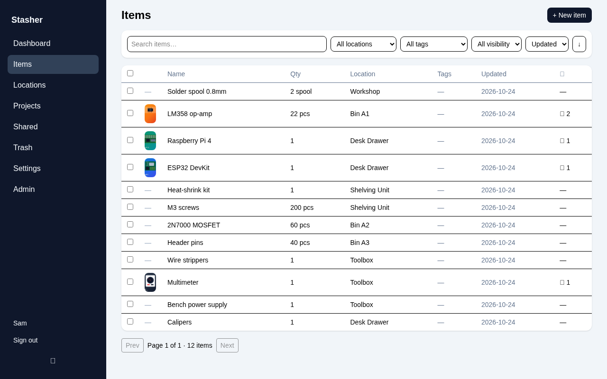
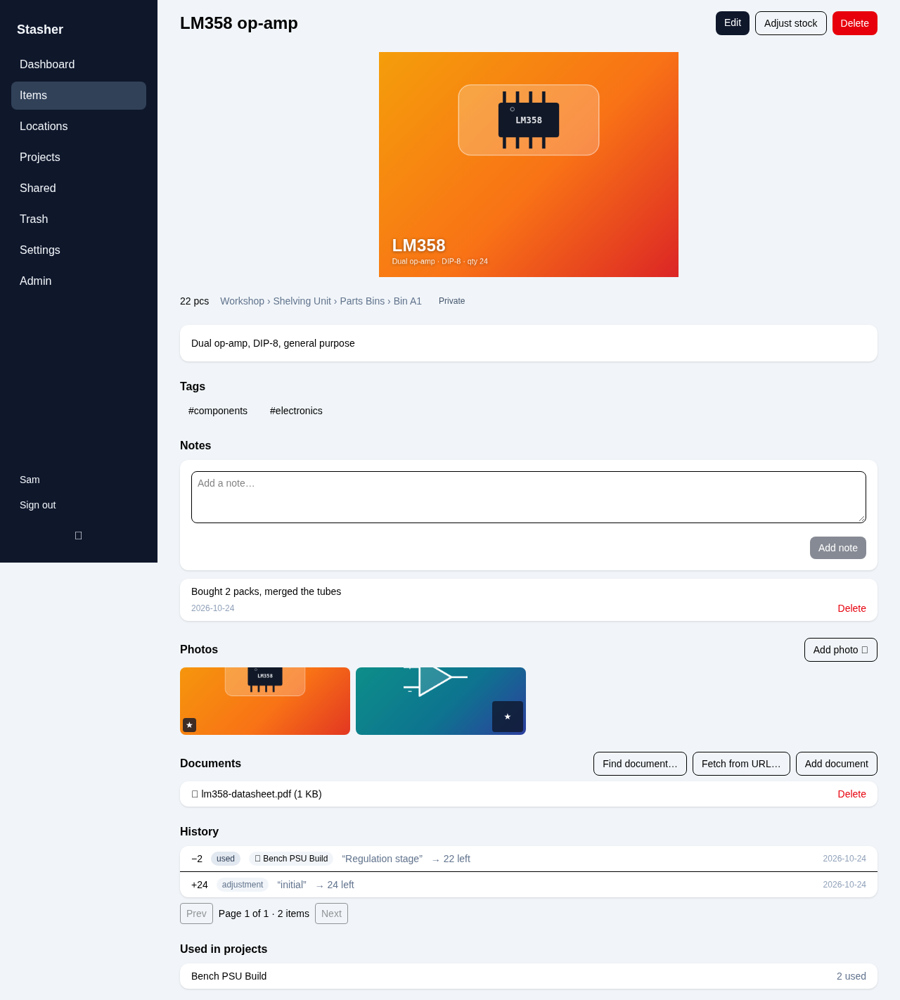
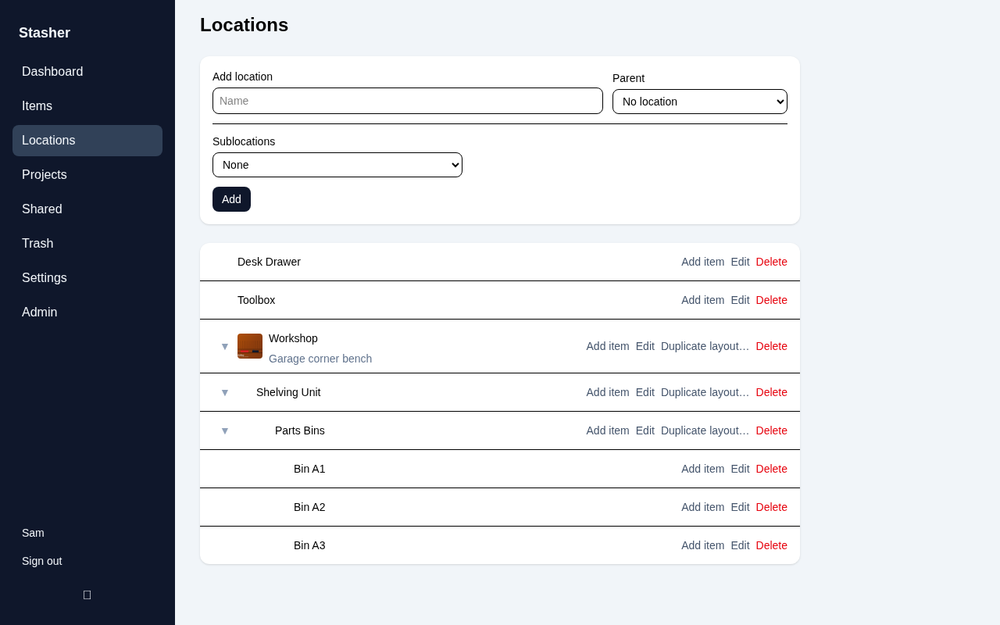
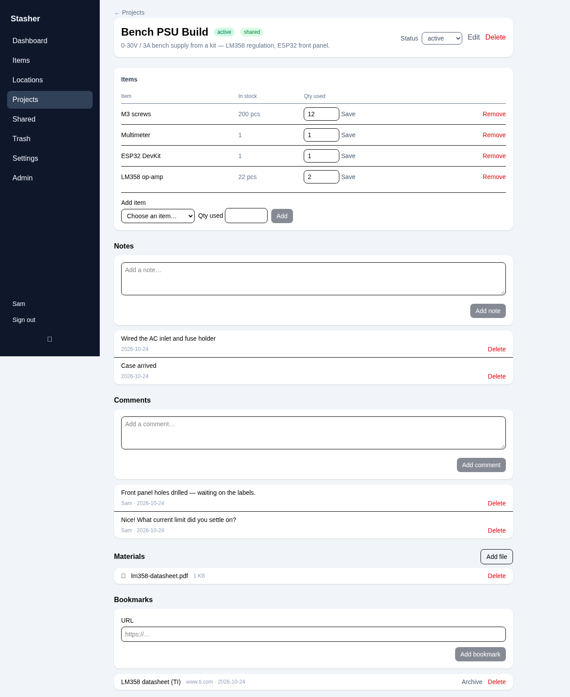
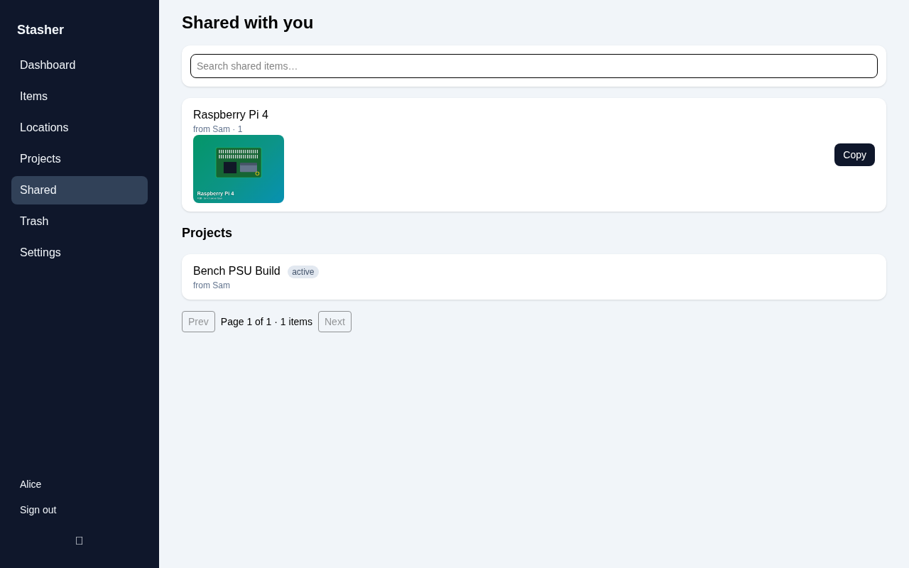
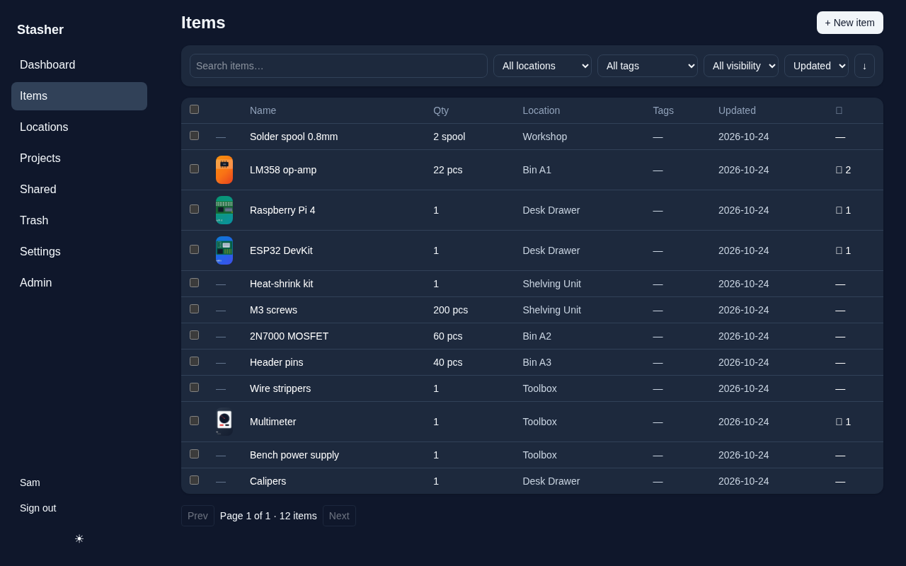

# Stasher

Self-hosted home inventory: know what you own and where it is.

- Single Go binary + SQLite (WAL) + files on disk — back up one data dir
- Items with quantity, tags, timestamped notes, usage history (used / sold /
  restock / disposed), photos with derived thumbnails, documents (datasheets)
- Nested locations (building > cabinet > parts bin), breadcrumbs, location
  pictures, bulk grid generator for bins (flat or nested, A1…C9), layout
  copying and subtree delete
- Projects that link items and track quantity used; shared projects with
  comments, reference materials and bookmarks (with page archiving)
- Multi-select bulk move between locations; trash with restore and purge
- Full-text search (SQLite FTS5 trigram — substring matches, `raspb` finds
  "raspberry pi")
- Document finder that verifies candidates are real PDFs server-side
  (optional Brave API key); fetch any URL as a document, archive pages to
  PDF (optional chromium)
- AI autofill of item fields from photos (optional OpenAI-compatible key —
  point it at a local service to stay on-box)
- Multi-user with separate inventories; per-item sharing (view/copy)
- Invite-code registration, admin user management, device session control
- Mobile-friendly, installable PWA with light/dark theme; camera photo
  upload via the browser

## Screenshots

| | |
|---|---|
|  |  |
| Items — search, filters, thumbnails | Item detail — photos, notes, documents, history |
|  |  |
| Locations — nested tree with picture | Project — BOM, notes, comments, materials |
|  |  |
| Shared with you (another user) | Dark theme |

Regenerate them against a freshly seeded throwaway instance:

    node scripts/screenshots.mjs

## Run

    go build -o stasher ./cmd/stasher
    ./stasher                  # serves on 127.0.0.1:8080, data in ./data
    ./stasher -config stasher.yaml
    ./stasher migrate          # apply migrations and exit

Config: YAML file (`-config path`; see `stasher.yaml.example` for a
documented example — copy to `stasher.yaml`, gitignored), env overrides
`STASHER_*` (`LISTEN_ADDR`, `BASE_URL`, `DATA_DIR`, `REGISTRATION`,
`LOG_LEVEL`, `TRASH_RETENTION_DAYS`). Optional integrations (Brave search,
URL archiving, AI autofill) are off until their keys/paths are configured.

Deploying on Alpine, Debian or Arch — full install guide with Caddy TLS and
systemd/OpenRC service files: [docs/INSTALL.md](docs/INSTALL.md).
API contract quirks (PATCH semantics, search, file policy, sharing):
[docs/api-notes.md](docs/api-notes.md).

The first registered user becomes admin. In `registration: invite` mode the
first user needs no invite code; afterwards admins create codes in the admin UI.

Put Caddy (or any reverse proxy) in front for TLS:

    your.domain.com {
        reverse_proxy 127.0.0.1:8080
    }

## First-run security

- Register the admin account immediately after first start: the **first
  registration becomes admin**, so on an internet-facing host an unclaimed
  instance hands admin to whoever signs up first.
- Prefer keeping `registration: invite` (the default) for internet-facing
  deployments; use `open` only on trusted networks.

## Development

    make generate   # regenerate sqlc code after editing queries.sql
    make test       # go vet + go test
    make web-test   # frontend unit tests (vitest + vue-tsc)

Frontend dev — two terminals:

    make web-dev    # vite dev server on :5173, proxies /api and /files to :8080
    make run        # Go API on :8080

Before deploying, rebuild the embedded SPA and retest:

    make web        # cd web && npm ci && npm run build → internal/webfs/dist
    make build
    make check      # everything CI runs

The built SPA (`internal/webfs/dist`) is committed; `make web` regenerates it
via `npm ci` for reproducible output. `./scripts/smoke-web.sh` runs a
headless-Chromium smoke against the real binary (login render, mobile
screenshot, manifest served).

## PWA

Stasher is an installable PWA: served over HTTPS (or localhost) and added via
your browser's Install / Add to Home Screen option, it runs standalone with
its own icon.
